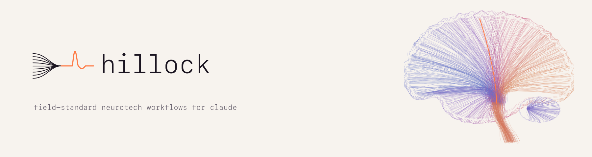

<p align="center">
  <picture>
    <source media="(prefers-color-scheme: dark)" srcset="banner-dark.png">
    
  </picture>
</p>

Hillock Labs builds open workflows for neural engineering: the methods,
defaults and checks that BCI, EEG/MEG, spike-sorting, real-time,
neuromodulation and device work depend on, packaged so an AI assistant
applies them correctly.

**[ultimate-neurotech-claude-skills](https://github.com/Hillock-NeuroTech/ultimate-neurotech-claude-skills)**: 32 skills, 6 agents
and 17 tested scripts for Claude Code, with a 46-task benchmark of the
mistakes they prevent.

```
/plugin marketplace add Hillock-NeuroTech/ultimate-neurotech-claude-skills
```

Corrections and reviews from practitioners are welcome; see the
[contributing guide](https://github.com/Hillock-NeuroTech/ultimate-neurotech-claude-skills/blob/main/CONTRIBUTING.md).
